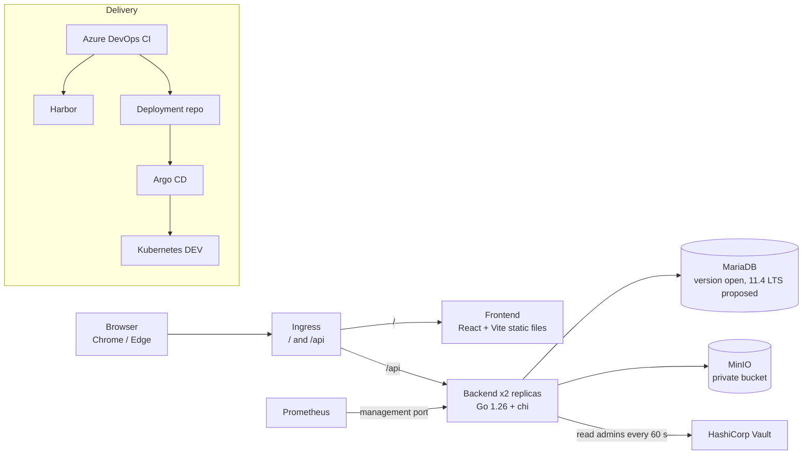

# Architecture Overview
 
| | |
|---|---|
| Version | 0.8 (system-level hub; backend and front end in their own documents) |
| Date | 2026-11-08 |
| Companion of | `docs/PRD.md` v1.5 |
| Status markers | **[Decided]** agreed in discussion · **[Proposed]** drafted by the architect, awaiting confirmation · **[Open]** unresolved (tracked in `docs/Open-items.md`) |
 
This document holds what is true for the whole system: principles, context and containers, delivery and operations, and the decision log. Requirements live in the PRD. Unresolved questions live in `docs/Open-items.md` and are cited here as OI-nn.
 
Changes in 0.8: Go rewrite of principle 1, container diagram, §12 and §14; Java-era decisions marked Superseded; document map updated to the current file names; delivery tracking moved to beads.

Changes in 0.7: decisions D57–D61 for the Go backend added to the decision log (Go 1.26, non-strict generated server, chi, status 413 for oversized JSON bodies, sqlc schema conversion); document map extended with `Backend.md` and the sqlc spike annex. Version 0.8: the Java-specific text of this file (principle 1, container diagram, §12, D1, D6, D28, D31, D33, D41, D43, D46) is rewritten for Go or marked **Superseded** in the log.
 
Changes in 0.6: decisions D53–D56 from the `shared` module guide (`docs/modules/shared.md`) added to the decision log; module guides added to the document map.
 
Changes in 0.5: open points (former §14 table) moved to `docs/Open-items.md`; decision-log statuses carry their OI id; document map extended; PRD references updated to v1.5.
 
Changes in 0.4: results of the implementation-readiness review recorded as D40–D52; MariaDB version reopened; open points refreshed.
 
Changes in 0.3: backend design moved to `Backend.md`; front end moved to `Frontend.md`; core sequence diagrams added in `Sequence.md`; storage-consistency rule for unknown transaction outcomes, validate-before-upload, temporary-file spooling and 413 precedence recorded (D35–D39).
 
---
 
## 0. Document map
 
| Document | Content |
|---|---|
| `Architecture.md` (this file) | Principles, system context, delivery and operations, decision log |
| `Backend.md` | Go backend: modules, dependency rules, stack, package layout, sqlc rules, request pipeline, transactions, session and CSRF middleware, audit, uniform 404, multi-replica behaviour (including Vault sync), data model, tests. The Java design it replaced is no longer kept |
| `Frontend.md` | Stack, feature folders aligned with backend modules, contract with the API, localization |
| `Sequence.md` | Sequence diagrams: create, replace, delete, download; transaction-outcome and storage-consistency rules |
| `../modules/` | **[Planned]** module guides (concepts, file map, invariants, change recipes); not yet written |
| `../PRD.md` | Requirements |
| `../API/` | API contract: `README.md`, `api-endpoints.md`, `error-codes.md`, `response-bodies.md` |
| `../Open-items.md` | Single tracker of unresolved questions, owner confirmations and platform answers (OI-nn) |
| `../PR-plan.md` | Pull-request breakdown, slices S0–S7, Definition of Done, milestones. Tracked as beads issues (`bd`), not Linear |
| `../Adr/0001-Backend-in-go.md` | ADR: the backend is implemented in Go (accepted 2026-11-08) |
| `../Adr/0001-Annex-sqlc-spike.md` | Annex to ADR-0001: result of the sqlc spike, rules R1–R5, conversion script |
 
**Moved sections** (section numbers of the former Java `overview` 0.2, kept so that existing references still resolve):
 
| Old section (overview 0.2) | Now in |
|---|---|
| §3 Modules | `Backend.md` §2 |
| §3.1 Dependency rules and code layout | `Backend.md` §2.1 – §2.5 |
| §4 Request Pipeline and Check Order | `Backend.md` §3 |
| §5 Transactions and Consistency | `Backend.md` §4 |
| §6 Key Flows | `Sequence.md` (create, replace, delete, download); `Backend.md` §5 (join requests) |
| §7 Authentication and Session | `Backend.md` §6 |
| §8 Audit | `Backend.md` §7 |
| §9 Uniform 404 and Timing | `Backend.md` §8 |
| §10 Multi-Replica Behaviour | `Backend.md` §9 |
| §11 Data Model | `Backend.md` §10 |
| §13 Front End | `Frontend.md` |
| §14 Open Points (table of 0.4) | `../Open-items.md` (mapping in its §6) |
 
---
 
## 1. Principles
 
1. **Simple deployment shape.** A modular monolith, one Go module, no microservices, no message queue. **[Decided]**
2. **Split by feature, not by layer.** Packages follow business capabilities. **[Decided]**
3. **The database is the referee.** Constraints go into the database wherever it can enforce them; the application performs only the first-line check. **[Decided]**
4. **One clock.** Database time is the only time authority. **[Decided]**
5. **Fail closed for audit.** A successful write exists only together with its audit row. **[Decided]**
6. **No distributed transactions, replication management or off-site copies** are part of this project. Database and MinIO availability are platform concerns. **[Decided]**
7. **Reduce code where the product allows it.** Invitations were replaced by join requests for this reason. **[Decided]**
8. **Never delete what might be referenced.** When a database outcome is unknown, storage objects are kept and cleaned up later by a rule that checks references. **[Decided]**
9. **Framework defaults do not decide behaviour.** Where a framework default (HTTP router, JSON decoder, session and CSRF libraries) differs from the PRD, the PRD wins, and the chosen behaviour is locked by a test. **[Decided]**
---
 
## 2. System Context and Containers
 

 
- The front end and the API share one origin; no CORS. **[Decided]**
- Sessions, throttle counters and all state live in MariaDB, so any replica serves any request (no sticky sessions). **[Decided]**
- Slides are streamed through the backend; no pre-signed MinIO URLs (5 MiB is small). **[Decided]**
- Probes and metrics listen on a separate management port (second `http.Server`) that the public ingress does not route.
---
 
## 12. Delivery and Operations
 
- **Separate deployment repository** holds the Helm chart and per-environment values; the application pipeline commits the new image tag there, which also avoids re-triggering itself. **[Decided]**
- Migration is an Argo CD `PreSync` Job running Flyway; the application does not run Flyway. Expand-then-contract only.
- Two backend replicas, startup/liveness/readiness probes. Readiness depends on MariaDB and the first Vault read, not on MinIO.
- Pods: `runAsNonRoot`, all capabilities dropped, seccomp `RuntimeDefault`, `readOnlyRootFilesystem`, `emptyDir` on `/tmp` (`sizeLimit` about 256 MiB) for upload spooling; `GOMEMLIMIT` at about 75 % of the container limit. **[Proposed]**
- Ingress body-size limit 6 MiB; the application enforces the exact 5 MiB slide limit (PRD §6.8). The platform's answer is OI-06.
- JSON logs on stdout (ECS format **[Proposed]**) with `requestId` on every line; a test proves that passwords, session IDs and tokens never appear.
- OpenAPI generated from code, compared with the committed snapshot and linted with Spectral in CI (`Backend.md` §11).
- Committed non-functional items: **API Spec, Structured Logging, Availability, Fault Tolerance** **[Decided]**. Reliability and Performance are targets only; Monitoring is not committed (OI-05).
---
 
## 14. Next Steps
 
Open points are tracked in `docs/Open-items.md`; the ones that concern this document are OI-04 (MariaDB and MinIO versions), OI-10 / OI-11 (D41, D42), OI-13 (D51), OI-18 (D34), OI-19 (grace period), OI-30 (hash-chain ADR), OI-31 (Spring Boot 4 compatibility, risk accepted) and, for the Go backend, OI-50 (JSON body limit and error code), OI-51 (sqlc on the real schema) and OI-52 (minio-go single attempt).
 
Resolved: CSRF binding (D40, decided by the owner); email whitespace rule (PRD §6.3); delete returns 204 everywhere; table name `pending_file_deletion`; oversized-body error precedence (D39); PRD package list (PRD 1.2); the four gaps of the `shared` module guide (D53–D56); the Go design choices D57–D60. The full list is in `Open-items.md` §5.
 
Next deliverables: ADR drafts for the decisions below; Flyway migration plan for the first schema; import-graph test and `depguard` rules (`Backend.md` §2.4); `testdata/schema/` files; module guides (`docs/modules/`); sequence diagrams for the remaining flows only if needed (join requests are database-only).
 
---
 
## 15. Decision Log
 
| # | Decision | Rationale | Status |
|---|---|---|---|
| D1 | Modular monolith, single Maven module, feature packages | Scale does not justify microservices | **Superseded by D57 (Go module; feature packages unchanged)** (was: Decided) |
| D2 | Audit success rows in the business transaction; no MQ | Fail-closed; same database; async would lose events | Decided |
| D3 | Audit rejected attempts in a separate transaction | Business rollback would erase them | Decided |
| D4 | No distributed transactions, replication or off-site backup in scope | Platform concern | Decided |
| D5 | Stream slides through the backend, no pre-signed URLs | 5 MiB is small; keeps access control in one place | Decided |
| D6 | Spring Session filter + cookie, custom repository on own table | Database time authority; hashed session IDs | **Superseded by ADR G11 (own session middleware)** (was: Decided (superseded if D41 / OI-10 is approved)) |
| D7 | READ COMMITTED; `SELECT NOW(6)` in the transaction; deadline read without shared lock | Race is rare and acceptable | Decided |
| D8 | Idea row `FOR UPDATE` serializes team operations | Capacity rule | Decided |
| D9 | Uniform 404 designed up front via one visibility query | Prevents enumeration by response or timing | Decided |
| D10 | Deployment manifests in a separate repository | Clean GitOps; no pipeline loop | Decided |
| D11 | Front end React + Vite; VitePress stays Vue | Team preference | Decided |
| D12 | NFR commitments: API Spec, Structured Logging, Availability, Fault Tolerance | Avoid a single point of failure in grading | Decided |
| D13 | 365-day audit retention is acceptable | Small data volume | Decided |
| D14 | UTC everywhere; `utf8mb4`; `utf8mb4_bin` for email and Idea name | Correct uniqueness for names and e-mail | Decided |
| D15 | Enums as `VARCHAR` + `CHECK` | Easier expand-then-contract | Decided |
| D16 | Public IDs are UUID | No guessable IDs | Decided |
| D17 | Constraints pushed to the database; application does first-line checks | Consistency under concurrency | Decided |
| D18 | Invitations removed; users join by leader employee ID + Idea name, leader approves | Less code; invitation was our own design, not an organizer requirement | Decided |
| D19 | `idea_member` carries `status` (`PENDING`, `ACCEPTED`); other transitions delete the row | History kept only in the Audit Log | Decided |
| D20 | Idea names unique per leader, not globally | Join requests carry the leader employee ID | Decided |
| D21 | Existence leak through join requests accepted; no cap on pending requests | Low risk, less code | Decided |
| D22 | Slide metadata embedded in `idea` as non-null columns | Database enforces "no Idea without slides" | Decided |
| D23 | `audit_log.id` is a BIGINT sequence | Basis for the hash chain; Admin-visible only | Decided |
| D24 | `login_attempt` (IP events) and `login_lock` (key state) as two tables | Sliding window needs events; key lock needs explicit state | Decided |
| D25 | `pending_file_deletion` written in v1; drain job is the next phase | Fault Tolerance now, clean-up later | Decided |
| D26 | No `job_lease` table in v1 | Idempotent operations and `SKIP LOCKED` are enough | Decided |
| D27 | MariaDB 10.8 LTS with native `UUID` and `INET6` | Version confirmed by the owner | **Reopened** (D45) |
| D28 | No dedicated Spring Boot 4 compatibility spike | Owner decision; risk accepted | **Superseded: no Spring in the Go backend (OI-31 closed)** (was: Decided (OI-31)) |
| D29 | Split `slides` into `storage` (no dependency on `idea`) and `slides` (HTTP orchestration on top of `idea` + `storage`) | Removes the `idea` ↔ `slides` cycle | Decided |
| D30 | Split `auth` into `account` and `auth`; `account` defines `SessionRevoker`, `auth` implements it | Smaller modules; Vault uncertainty isolated; no cycle | Decided |
| D31 | Repositories use `JdbcClient`, hand-written SQL owned by each module, no JPA | Locking, upserts, atomic session statement and visibility query are SQL by design | **Superseded by ADR G1 (sqlc, hand-written SQL per module; intent unchanged)** (was: Decided) |
| D32 | `shared` depends on no business module and contains no business concept | Reusable, trivially testable kernel | Decided |
| D33 | `internal/` classes are `public`; module isolation enforced by ArchUnit in CI | Java package-private does not cross sub-packages | **Superseded by ADR G6 (Go `internal/` rule, import-graph test, `depguard`)** (was: Decided) |
| D34 | `deadline` exposes `SubmissionGate` (`precheck`, `assertOpenInTx`) for every state-limited write | One place for deadline logic and the PRD §5 double check | Proposed (OI-18) |
| D35 | Architecture documentation split: `Architecture.md` (system), `Backend.md`, `Frontend.md`, `Sequence.md` | Backend and front end documented side by side; smaller documents | Decided |
| D36 | After an upload, a **known rollback** deletes the new object at once; an **unknown** outcome records the key as `UPLOAD_ABORTED`; the clean-up job deletes it only after a grace period and only if no `idea.slides_object_key` references it | A lost `COMMIT` acknowledgement must never leave an Idea pointing at a deleted file | Decided (grace period: OI-19) |
| D37 | All text and file validation completes before the MinIO upload | A rejected request never creates a storage object | Decided |
| D38 | Request bodies are spooled to a temporary file (size and SHA-256 computed while streaming), removed in `finally` | Bounded memory under concurrency | Decided |
| D39 | A transport-level size limit may answer 413 before any other check; bodies are not drained to produce an earlier 401/403/404 | 5 MiB cap keeps the attack surface small; simplest behaviour | Decided |
| D40 | CSRF token is HMAC-signed over a **session binding** (SHA-256 of the session ID, or a fixed anonymous value before login); cookie `__Host-csrf`; token changes at login and logout | An unbound signature proves only that the server issued the token; anyone can obtain one from `GET /auth/csrf`. Binding makes a token useless against another session | Decided (owner, 2026-11-08) |
| D41 | Replace Spring Session with an own session filter plus a `SecurityContextRepository` that rebuilds the principal from `app_user` on every request | The PRD needs only ID generation, cookie, one atomic SQL statement and no attributes; `SessionRepository`'s find/save cycle and Spring Security's session-stored context fit poorly | **Superseded by ADR G11 (own session middleware; intent unchanged)** (was: Proposed (owner, OI-10)) |
| D42 | Session idle refresh at most once per 60 s inside the atomic statement | Removes a write from most requests; effective idle timeout 29–30 min | Proposed (owner, OI-11) |
| D43 | Own CSRF filter placed after the session filter; Spring Security's `CsrfFilter` disabled | The built-in filter runs before authentication (wrong order 401 → CSRF) and falls back to `getParameter`, which parses multipart bodies early | **Superseded by ADR G11 (own CSRF middleware; intent unchanged)** (was: Proposed) |
| D44 | Commit-outcome classification: exception before `commit()` → known rollback; `commit()` failing with SQLState class `23` or `40` → known rollback; **every other `commit()` failure → unknown** | Conservative per principle 8: misclassifying a rollback as unknown only delays clean-up | Proposed |
| D45 | MariaDB version reopened; proposed **11.4 LTS** (maintained until 2029-05); minimum 10.7 for native `UUID` | 10.8 was a short-term release and is end of life | Open (platform, OI-04) |
| D46 | JSON binding: absent / `null` / wrong type → 400; empty after clean-up → 422 `REQUIRED`; unknown fields ignored; duplicate keys → 400; scalar coercion disabled; defaults locked by tests (Go `encoding/json`, handlers decode their own bodies; D58) | One clear line between malformed requests and validation errors; PRD §6.6 requires a client-sent leader to be ignored | Proposed |
| D47 | Slide downloads set `Content-Length`, abort the connection on a mid-stream storage failure, reject `HEAD` with 405 and do not support `Range` | Spring MVC answers `HEAD` with the `GET` handler, which would write a download audit row | Proposed |
| D48 | Audit: 404 on Idea paths audited for both "missing" and "not yours"; 409 / 422 not audited except registration; unmatched routes not audited | Uniform 404 must include the audit write; input errors are not rejected attempts | Proposed (OI-16) |
| D49 | Name search `LOWER(name) LIKE LOWER(?)` on the `utf8mb4_bin` column; ordering by code point | `LIKE` on a binary collation is case-sensitive; `_ci` collations would equate é and e and disagree with uniqueness | Proposed |
| D50 | Object key `slides/{ideaId}/{uuid}.{ext}`; MinIO client connect timeout 2 s, read/write 30 s, no retries | No personal data in keys; failures map to 503 quickly | Proposed (Go: `MaxRetries: 1`, OI-52) |
| D51 | Vault sync: entries colliding with a self-registered User are skipped; removed-then-readded Admins are re-enabled; name/hash changes synced, hash change revokes sessions; bcrypt cost ≠ 10 rejected | A User may already be a Leader/Member; a different cost leaks Admin IDs through timing | Proposed (cost rule: OI-13) |
| D52 | `testdata/` files each have a JSON Schema in `testdata/schema/`, validated in CI | Front end and back end read the same files | Proposed |
| D53 | Track-B audit is reached through a port: `shared/web` defines `RejectedRequestListener`, `audit` implements it; the central exception handler and the filters (CSRF, session) call the port | The handler lives in `shared`, which may not depend on `audit` (D32); same pattern as `SessionRevoker` (D30) | Decided (owner, 2026-11-08) |
| D54 | `shared` defines an `ErrorCode` interface (code, HTTP status) and the generic codes; each module defines an enum with its own codes; a contract test checks that the union of all enums equals `testdata/error-codes.json` | Keeps business codes (`IDEA_DUPLICATE`, `TEAM_FULL`) out of the kernel (D32) while keeping one machine-checked catalogue | Decided (owner, 2026-11-08) |
| D55 | API timestamps are truncated (not rounded) to milliseconds; locked by a test | Rounding can move a value into the next second, e.g. a deadline shown next to `serverTime`; truncation never moves a time forward | Decided (owner, 2026-11-08) |
| D56 | A malformed ID on an Idea path returns the uniform 404 and is audited as DENIED (reason `NOT_FOUND`, `targetId` null, route template recorded) | One rule for every 404 on an Idea path (PRD §6.11); no special case to test or explain | Decided (owner, 2026-11-08) |
| D57 | The backend is built with **Go 1.26**: `go 1.26` and a `toolchain` line with the latest 1.26 patch at the start of S0 (1.26.10 on 2026-11-08); CI and the container build use the same version | Owner instruction; the spike, the router check and the `encoding/json/v2` check were run on 1.26.10 | Decided (owner, 2026-11-08) |
| D58 | oapi-codegen generates the **standard (non-strict)** chi server interface; each handler decodes its own body | The strict server decodes JSON before the handler (400 before 404 / role 403 / state 403) and uses `encoding/json`, which accepts duplicate keys | Decided (owner, 2026-11-08) |
| D59 | The router is **chi**; `HEAD` on the slide download answers 405 (explicit route plus a test, on top of the router default) | `ServeMux` answers `HEAD` with the `GET` handler and writes plain-text 404 / 405; chi's hooks produce problem+json (checked on Go 1.26.10) | Decided (owner, 2026-11-08) |
| D60 | An oversized JSON request body answers **413** before any other check, as D39 does for files. Limit proposed 16 KiB; new error code `REQUEST_TOO_LARGE` proposed | The largest JSON body stays under 5 KiB; `FILE_TOO_LARGE` names a file | Status decided (owner, 2026-11-08); limit and code Proposed (OI-50) |
| D61 | sqlc reads a **script-converted schema** (`UUID` → `CHAR(36)`, `INET6` → `VARCHAR(45)`) with generated per-column Go type overrides; CI rejects generated SQL that still contains `sqlc.*` calls; row comparisons are not used; dynamic `ORDER BY` is hand-written | sqlc's MySQL parser rejects native `UUID` / `INET6` and silently leaves some `sqlc.arg` calls unreplaced (spike: `Adr/0001-Annex-sqlc-spike.md`) | Proposed (OI-51) |