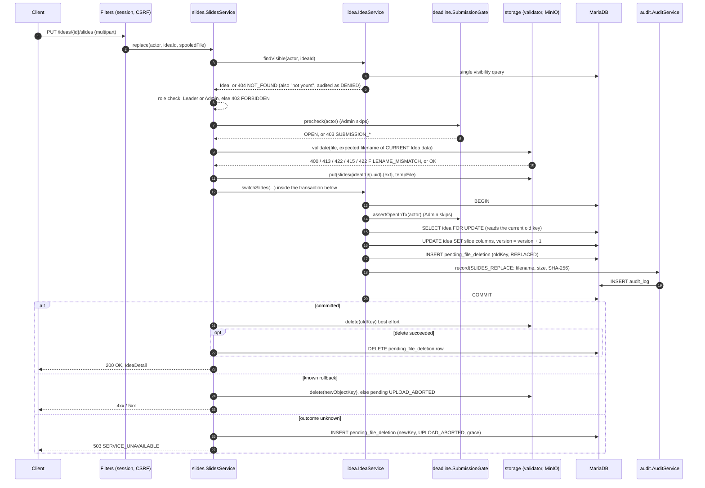
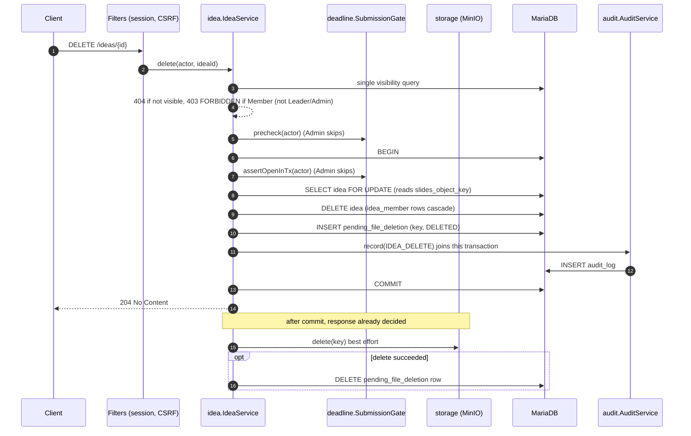
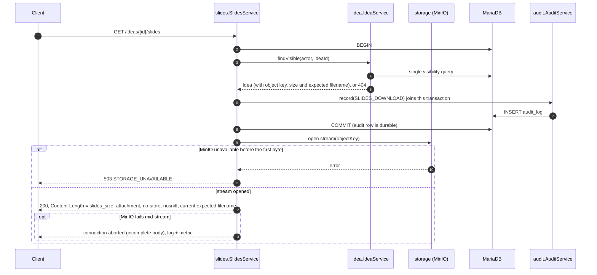

# Sequence Diagrams — Core Write and Read Flows
 
| | |
|---|---|
| Version | 0.3 |
| Date | 2026-11-08 |
| Companion of | `docs/PRD.md` v1.5, `docs/Architecture/Backend.md` v0.3 |
| Status markers | **[Decided]** agreed in discussion · **[Proposed]** drafted by the architect, awaiting confirmation (open points: `docs/Open-items.md`) |
 
Covers the flows that touch both the database and MinIO: **Create Idea, Replace slides, Delete Idea, Download slides**. Team (join request) flows are database-only and are described in `Backend.md` §5.
 
Participants use the module names of `Backend.md` §2.
 
This document is also the home of the mechanism behind PRD §6.8 (Storage consistency): §2 holds the outcome classification, the compensation per case and the clean-up rule per reason. The PRD keeps only the requirements.
 
Changes in 0.3: PRD references updated to v1.5; §2 absorbs the "not tracked in v1" note from PRD §6.8 and cites OI-19 for the grace period.
 
Changes in 0.2: exact commit-outcome classification (§2, D44); object key format; download headers, `HEAD` and mid-stream failure (§6, D47); test list extended (§7).
 
---
 
## 1. Conventions used in all diagrams
 
**Check order** (PRD §6.1): 401 → CSRF 403 → 404 → role 403 → state 403 → validation. The authoritative state check is repeated inside the write transaction.
 
**Decisions that shape every flow** **[Decided]**
 
| # | Decision |
|---|---|
| S1 | The request body is spooled to a **temporary file** while counting bytes and computing SHA-256; the file is removed in a `finally` block. |
| S2 | **All text-field and file validation completes before the object is uploaded to MinIO**, so a rejected request never creates a storage object. |
| S3 | A transport-level body limit may answer **413 before any other check** (PRD §6.1). Oversize bodies are not drained to produce an earlier 401/403/404. |
| S4 | Every upload writes a **new object key** (`slides/{ideaId}/{uuid}.{ext}` **[Proposed]**). The database pointer is switched inside the write transaction. |
| S5 | Compensation after a failed transaction depends on whether the outcome is **known** (§2 below). |
 
---
 
## 2. Transaction outcome classification and compensation **[Decided]**
 
After the new object is uploaded, the write transaction may end in one of three ways. Classification by **where** the failure happened **[Proposed]** (D44):
 
| Outcome | How it is recognised | Compensation for the **new** object key |
|---|---|---|
| **Committed** | `commit()` returned success | None. |
| **Known rollback** | Any exception raised **before** `commit()` was called (including validation, `assertOpenInTx`, constraint violations, deadlock, lock-wait timeout, audit failure); or `commit()` failed with SQLState class `23` or `40` | Delete the object now (best effort). If that delete fails, insert the key into `pending_file_deletion` with `reason = UPLOAD_ABORTED` (separate best-effort transaction). |
| **Unknown** | `commit()` failed in any other way (connection lost, timeout, unexpected error) | **Do not delete.** Insert the key into `pending_file_deletion` with `reason = UPLOAD_ABORTED` and `next_attempt_at = now + grace period`. Respond 503 `SERVICE_UNAVAILABLE`. |
 
Why: if `COMMIT` succeeded but the acknowledgement was lost, deleting the new object would leave the Idea pointing at a missing file. The server may even finish a commit after the client has given up. Misclassifying a rollback as unknown only delays the clean-up, so every doubtful case is "unknown".
 
Note: `database/sql` returns one generic error for every commit failure; the classifier (`shared/db.InTx`) inspects the error instead (`Backend.md` §4.4).
 
**Replaced and deleted objects.** The old key of a replacement (`REPLACED`) and the keys of a dissolved Idea (`DELETED`) are inserted into `pending_file_deletion` in the same transaction as the change (§4, §5). The object is deleted after commit; if MinIO is down the row stays for the clean-up job, so replace and delete never fail because of storage.
 
**Not tracked in v1 (PRD §10).** An object left behind by a process crash between the upload and the transaction has no row in `pending_file_deletion` and is not found by the job.
 
**Clean-up job rule** (drained in the next phase, written in v1):
 
| `reason` | Meaning | Job action |
|---|---|---|
| `REPLACED` | Old key, inserted in the same transaction that switched the pointer | Delete the object directly (no one references it once committed). |
| `DELETED` | Key of a dissolved Idea, inserted in the delete transaction | Delete the object directly. |
| `UPLOAD_ABORTED` | New key whose transaction failed or ended unknown | Delete **only if** (a) `next_attempt_at` has passed (grace period, **[Proposed]** 10 minutes, OI-19, longer than the maximum lock-wait plus transaction time) **and** (b) no row in `idea` has `slides_object_key` equal to the key. If an `idea` row references it, the commit did succeed: remove the pending row and keep the object. |
 
---
 
## 3. Create Idea (`POST /ideas`, multipart)
 
```mermaid
sequenceDiagram
    autonumber
    participant C as Client
    participant F as Filters (session, CSRF)
    participant I as idea.IdeaService
    participant G as deadline.SubmissionGate
    participant S as storage (validator, MinIO)
    participant DB as MariaDB
    participant A as audit.AuditService
 
    C->>F: POST /ideas (multipart)
    Note over F: transport size limit may answer 413 here (S3)
    F->>DB: atomic session check, 401 if invalid
    F-->>F: CSRF check (session-bound token), 403 CSRF_INVALID
    F->>I: create(actor, form, spooledFile)
    Note over I: body spooled to temp file, size and SHA-256 computed (S1)
    I-->>I: role check, User only, 403 FORBIDDEN
    I->>G: precheck(actor)
    G->>DB: SELECT NOW(6) and deadline (no lock)
    G-->>I: OPEN, or 403 SUBMISSION_NOT_OPEN / SUBMISSION_CLOSED
    I-->>I: missing part or field 400; clean up text fields, validate (422, incl. INVALID_NAME_CHARS, FILENAME_TOO_LONG)
    I->>S: validate(file, expected filename)
    S-->>I: 413 / 422 EMPTY_FILE / 415 / 422 FILENAME_MISMATCH, or OK (S2)
    opt optional read-only duplicate check
        I->>DB: SELECT 1 FROM idea WHERE leader_id = ? AND name = ?
        I-->>C: 409 IDEA_DUPLICATE (nothing uploaded)
    end
    I->>S: put(slides/{newIdeaId}/{uuid}.{ext}, tempFile)
    alt MinIO unavailable
        S-->>I: error
        I-->>C: 503 STORAGE_UNAVAILABLE (no row, no object)
    end
    I->>DB: BEGIN (READ COMMITTED)
    I->>G: assertOpenInTx(actor)
    I->>DB: INSERT idea (slide columns included)
    I->>A: record(IDEA_CREATE) joins this transaction
    A->>DB: INSERT audit_log
    I->>DB: COMMIT
    alt committed
        I-->>C: 201 Created, IdeaDetail, Location
    else known rollback (409 IDEA_DUPLICATE, 403 SUBMISSION_CLOSED, audit failure, SQLState 23/40 on COMMIT)
        I->>S: delete(newObjectKey) best effort
        opt delete failed
            I->>DB: INSERT pending_file_deletion (UPLOAD_ABORTED), separate tx
        end
        I-->>C: 409 / 403 / 5xx
    else outcome unknown (any other COMMIT failure)
        I->>DB: INSERT pending_file_deletion (UPLOAD_ABORTED, next_attempt_at = now + grace), separate tx, best effort
        I-->>C: 503 SERVICE_UNAVAILABLE
    end
    Note over I,S: temp file removed in finally (S1)
```
 
Notes:
 
- The Leader's name for the expected filename comes from the authenticated account, never from the form (PRD §6.6).
- The Idea ID is generated by the application before the upload, because the object key contains it.
- A MinIO failure at step "put" leaves nothing behind: no row exists and no later step has run.
- The optional duplicate pre-check avoids an upload in the common case; the unique key stays authoritative.
- A DENIED outcome (CSRF, role, state) is audited from the central exception handler through `recordRejected` in a separate transaction; it is omitted from the diagram to keep it readable.
---
 
## 4. Replace slides (`PUT /ideas/{id}/slides`)
 
Callable by the Leader (state-limited) and by an Admin (not state-limited).
 

 
Notes:
 
- The Idea row is locked with `FOR UPDATE` so two concurrent replacements cannot read the same old key and orphan one object. No MinIO call happens while the lock is held (the upload is done before the transaction, the old-object delete after commit).
- If the outcome is unknown, the state is still consistent: when the commit did succeed, the `REPLACED` row for the old key exists and the new key is referenced (the job keeps it); when it did not, the old key is still referenced and the new key is cleaned up after the grace period.
- Slide replacement bumps `version` (optimistic-locking bonus).
---
 
## 5. Delete Idea (`DELETE /ideas/{id}`)
 
Callable by the Leader (state-limited) and by an Admin. No upload is involved.
 

 
Notes:
 
- MinIO being down does not change the result (Fault Tolerance, PRD §8.2): the key stays in `pending_file_deletion` for the clean-up job.
- The post-commit delete runs after the response outcome is fixed; a failure there is logged and counted, never returned to the client.
- An unknown commit outcome on delete returns 503; no object has been touched, and the `DELETED` row exists only if the commit succeeded.
---
 
## 6. Download slides (`GET /ideas/{id}/slides`)
 

 
Notes:
 
- The file is served only after the audit row is committed (fail-closed). If MinIO then fails, the audit row exists for a download that returned 503; accepted, because the intent to download was real and the alternative would serve a file without an audit row.
- `Content-Length` lets the client detect an aborted transfer; no error body can be sent once headers are out. **[Proposed]** (D47)
- `HEAD` returns 405; a router that maps `HEAD` to `GET` would otherwise run this handler and write an audit row. `Range` is not supported.
- Downloads are not state-limited.
---
 
## 7. What these diagrams imply for tests
 
| Test | Covers |
|---|---|
| Create with MinIO down | no `idea` row, no object, 503 |
| Create with duplicate `(leader, name)` | pre-check: 409, nothing uploaded; race past the pre-check: known rollback, object deleted, 409 |
| Create where the deadline passes between pre-check and transaction | known rollback: object deleted, 403 `SUBMISSION_CLOSED` |
| Create with simulated lost `COMMIT` acknowledgement (committed) — `DataSource` proxy commits, then throws | object kept, 503, `UPLOAD_ABORTED` row removed by the job because an `idea` row references the key |
| Create with simulated lost `COMMIT` acknowledgement (not committed) — proxy throws without committing | `UPLOAD_ABORTED` row remains; job deletes the object after the grace period |
| `COMMIT` failing with SQLState `40` | classified as known rollback; object deleted |
| One Toxiproxy run cutting the connection around `COMMIT` | real-network sanity check of the classification |
| Concurrent replace of the same Idea | one wins; the other old key is not orphaned |
| Delete with MinIO down | 204, `DELETED` row remains |
| Download | audit row exists before the first byte; 503 when MinIO is down; `Content-Length` set; `HEAD` → 405 without an audit row |
| Upload with an NFD filename (macOS) | accepted after NFC normalization |